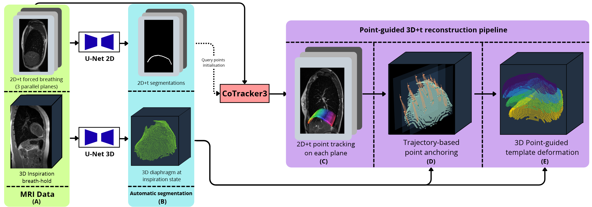

# diaph3dt: dynamic 3D reconstruction of the diaphragm

Code of the paper *3D+t Diaphragm Surface Reconstruction from Static 3D and 2D+t MRI*.

The diaphragm is reconstructed in 3D at every instant of free breathing from:

- a few **dynamic 2D+t MRI planes** per view (sagittal right `D`, sagittal left `G`, coronal `cor`),
  acquired in turn during free breathing;
- **static 3D MRI** at breath-hold (inspiratory, expiratory, spontaneous).

The pipeline needs the **segmentations** of the diaphragm (2D+t planes and 3D breath-holds) as
input; segmentation itself is not part of this repository. The weights of the 2D and 3D U-Net
segmentation models are available on request. No data is distributed.

## Pipeline overview



(A) MRI data: 2D+t planes acquired during breathing and a 3D inspiratory breath-hold.
(B) Automatic segmentation (U-Net 2D and 3D, not part of this repository: the segmentations are
the input of the code; model weights available on request). (C) Point tracking on each 2D+t plane with CoTracker3. (D) Anchoring of
the trajectories on the inspiratory template. (E) Point-guided deformation of the template at
each instant.

## Method

1. **Tracking** ([tracking.py](diaph3dt/tracking.py)). In each plane, 50 query points are placed
   on the medial line of the segmentation. To avoid depending on one reference frame, this is
   done at 15 anchor frames spread over the sequence, and each set is tracked over the whole
   sequence with CoTracker3. The consensus tracking is the medoid of the candidates (by chamfer
   distance between trackings), after discarding candidates farther than 3× the median distance.
   Points whose motion is inconsistent with their neighbours along the line (ratio > 20) are
   excluded as tracking errors. CoTracker's per-frame positional confidence is kept.
2. **Anchoring** ([anchoring.py](diaph3dt/anchoring.py)). Each tracked point is mapped to the
   scanner frame (the 2D and 3D acquisitions share it, no registration). Only frames with
   confidence ≥ 0.8 are kept. The resulting 3D trajectory crosses the upper (lung side) surface
   of the inspiratory template. The crossing closest to the mean of the crossings gives the point's
   rest position on the template (barycentric coordinates on the crossed face).
3. **Temporal assembly** ([timeline.py](diaph3dt/timeline.py)). The planes of a view are acquired
   in turn: frame *t* of plane *p* is placed at time *t + p/3*. Each control point is linearly
   interpolated in time at the instants of the other planes.
4. **Deformation** ([deformation.py](diaph3dt/deformation.py)). At each instant, the template
   follows the displacements of the control points. Methods: Gaussian RBF, RBF + affine,
   thin-plate spline, and biharmonic deformation along the surface. Rigid and affine
   least-squares fits are used as references.
5. **Evaluation** ([evaluation.py](diaph3dt/evaluation.py)). The reconstruction is compared with
   a 3D breath-hold segmentation that was not used to build it (spontaneous breath-hold, and the
   expiratory one). The compared instant *t\** is chosen before any deformation: it is where the
   tracked points lie closest to the reference surface. Metrics are NSD@τ (fraction of the
   reference within τ mm), ASSD, p90 and HD95. They are computed on the whole reference and
   between the extreme acquisition planes (`slab`). Parameters are selected on a tuning cohort
   (best mean NSD@3 mm on the spontaneous breath-hold) and then applied unchanged to a test
   cohort.

The respiratory level of a frame, *φ*, is the height of the dome (90th percentile of the
segmented heights). It is normalised between the inspiratory (*φ* = 0) and expiratory (*φ* = 1)
breath-holds, measured in the same plane.

## Installation

```bash
git clone https://github.com/Aarmadi/diaph-3D-t.git
cd diaph-3D-t
pip install -r requirements.txt
pip install -e .
```

CoTracker3 (`cotracker3_offline`) is downloaded through `torch.hub` at the first run. A GPU is
strongly recommended for tracking. Steps 2–5 run on a CPU.

## Data layout

All files are NIfTI, in the scanner (RAS) frame. `<subject>` is any identifier (e.g. `SUBJ01`),
`<view>` is `D`, `G` or `cor`, `<plane>` is the acquisition order of the plane within its view
(`0`, `1`, `2`).

```
<seg-dir>/
  <plane>_<subject>_<view>_seg.nii.gz         2D+t segmentation of a plane, shape (ni, nj, nt)
  <subject>_<state>_mask_diaphragme.nii.gz    3D breath-hold segmentation,
                                              <state> = inspi, expi, normal (spontaneous)
/
  <plane>_<subject>_<view>.nii.gz             2D+t images of the same plane
```

The images are only used by the tracker. `inspi` and `expi` are required; `normal` is the main
evaluation reference. If the 2D+t segmentations of a view are stored as one file with the planes
concatenated in time, `scripts/split_planes.py` splits them.

## Usage

```bash
# 1. Reconstruction (tracking, anchoring, temporal assembly), one folder per case
python scripts/reconstruct.py --seg-dir <seg-dir> --img-dir  --out-dir out

# 2. Evaluation of all methods over their parameter grids, selection of the best parameters
python scripts/evaluate.py --seg-dir <seg-dir> --img-dir  --out-dir out --jobs 8

# 3. Viewers opened on the selected method and parameters
python scripts/render.py --out-dir out
```

On a test cohort, the parameters of the tuning cohort are applied unchanged:

```bash
python scripts/reconstruct.py --seg-dir <test-seg> --img-dir <test-img> --out-dir out_test
python scripts/evaluate.py --seg-dir <test-seg> --img-dir <test-img> --out-dir out_test \
    --fixed-params out/best_params.json
python scripts/render.py --out-dir out_test --best-params out/best_params.json
```

`--subjects` and `--views` restrict any step to some cases. All defaults are the settings of the
paper.

## Outputs

```
out/
  <subject>_<view>/
    control_points.json   rest position of each control point and its positions over time
    mask_<state>.nii.gz   breath-hold masks restricted to the side seen by the view
    tracking.html         2D+t tracking of each plane (points, confidence, excluded points)
    anchoring.html        3D trajectories, crossings and anchors on the template
    reconstruction.html   dynamic reconstruction (method, kernel scale and regularisation
                          adjustable live; breath-hold surfaces as references)
  evaluation.csv          one row per case, method, parameters, reference and region
  best_params.json        selected parameters of each method
```

`evaluate.py` also prints the results table (mean metrics per reference, method and view).

## Repository

```
diaph3dt/        the package (one module per step, see above)
scripts/         command-line entry points
notebooks/       demo.ipynb: step-by-step walkthrough with figures (runs on synthetic data)
tests/           end-to-end test on a synthetic case (python -m pytest)
```

## Citation

If you use this code, please cite:

*3D+t Diaphragm Surface Reconstruction from Static 3D and 2D+t MRI.*
